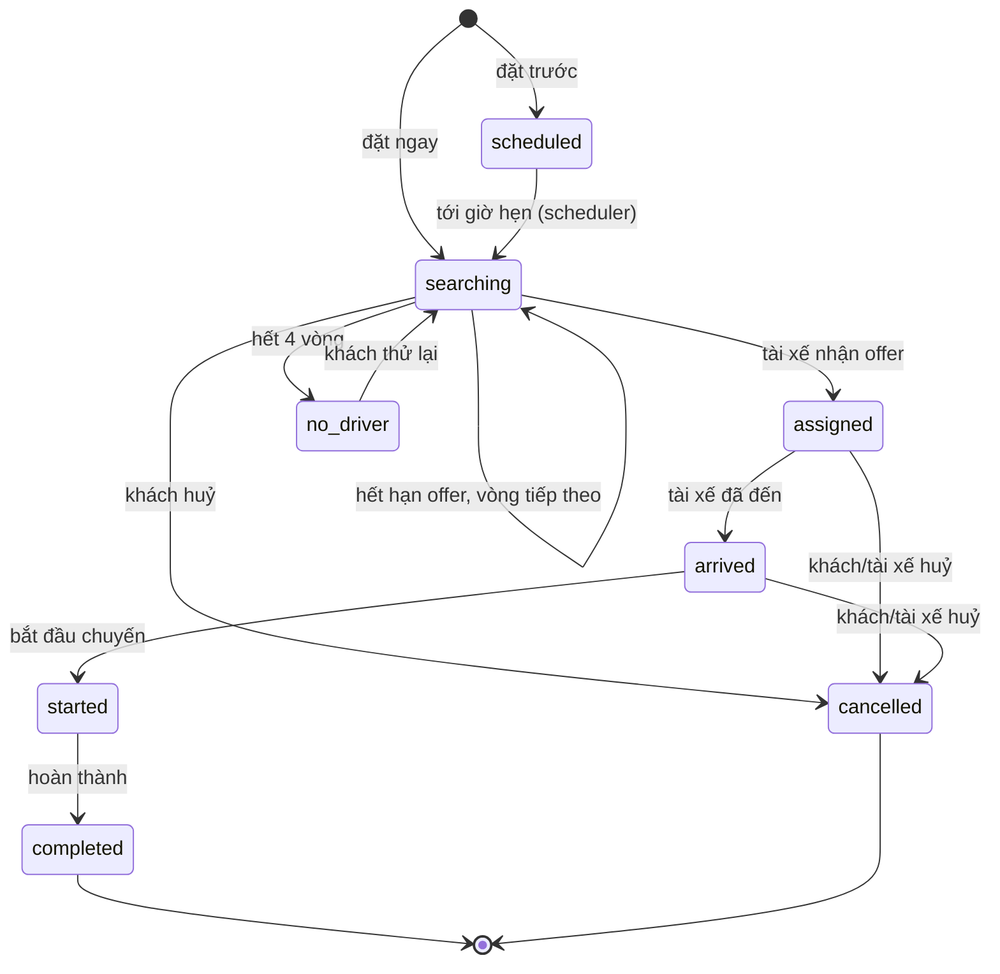

# XeGo — Nền tảng đặt xe và kết nối tài xế

XeGo là một nền tảng đặt xe theo yêu cầu hoạt động thật: khách chọn hành trình trên bản đồ, hệ thống tính giá, ghép tài xế đang online, đẩy trạng thái realtime cho cả hai phía, và quản trị viên theo dõi toàn bộ hoạt động.

Không phải mockup giao diện. Mọi thao tác đều ghi vào cơ sở dữ liệu, mọi trạng thái đều được đồng bộ qua Socket.IO, và mọi con số trên dashboard admin đều tính từ dữ liệu thật.

---

## 0. Bản demo trực tuyến

**🔗 <https://tuda1921.github.io/XeGo/>**

GitHub Pages chỉ phục vụ file tĩnh nên không chạy được Express + SQLite. Vì vậy bản demo dùng **backend mô phỏng chạy trong trình duyệt**: toàn bộ API được chặn bằng một `fetch` interceptor, dữ liệu khởi tạo là bản export thật từ server, và logic tính giá / ghép tài xế / chuyển trạng thái được port nguyên văn sang JavaScript phía client. Mọi thao tác (đặt xe, tài xế nhận chuyến, hoàn thành, thanh toán, đánh giá, quản trị) đều hoạt động và cập nhật realtime trong tab đang mở.

| Vai trò | Số điện thoại | Mật khẩu |
|---|---|---|
| Khách hàng | `0901234567` | `customer123` |
| Tài xế | `0901111222` | `driver123` |
| Quản trị viên | `0900000001` | `admin123` |
| Điều phối | `0900000002` | `operator123` |

Nút **"Bản demo tĩnh"** ở góc dưới bên phải hiển thị danh sách tài khoản này trên mọi trang.

Giới hạn của bản demo: dữ liệu chỉ nằm trong bộ nhớ tab (tải lại trang là reset), không gửi SMS/email thật, không gọi cổng thanh toán thật, và bản đồ dùng tile công khai của OpenStreetMap. Muốn chạy bản đầy đủ với cơ sở dữ liệu thật, xem mục 2 bên dưới.

---

## 1. Yêu cầu hệ thống

| Thành phần | Phiên bản tối thiểu | Ghi chú |
|---|---|---|
| Node.js | 20 LTS (đã kiểm thử trên 22.13.1) | Cần hỗ trợ ES Modules và `node --test` |
| npm | 10+ | Dùng npm workspaces |
| Trình duyệt | Chrome / Edge / Firefox / Safari bản mới | Cần hỗ trợ ES2022, CSS nesting không bắt buộc |

Không cần cài đặt cơ sở dữ liệu riêng — dự án dùng SQLite nhúng qua `better-sqlite3`.

---

## 2. Cài đặt và chạy

```bash
# 1. Cài dependencies cho cả monorepo
npm install

# 2. Tạo file cấu hình môi trường
#    Windows (PowerShell)
Copy-Item .env.example .env
#    macOS / Linux
cp .env.example .env

# 3. Chạy chế độ phát triển (API + web cùng lúc)
npm run dev
```

Sau khi chạy:

- Web khách hàng / tài xế / admin: <http://localhost:5173>
- API: <http://localhost:4000>
- Kiểm tra sức khoẻ API: <http://localhost:4000/api/health>

Lần chạy đầu tiên, nếu database trống và `SEED=true`, hệ thống tự tạo dữ liệu demo (17 người dùng, 10 tài xế, 10 xe, 8 chuyến đi, 8 loại xe, 4 mã khuyến mãi, 5 khu vực phục vụ).

### Chạy bản production trên một cổng duy nhất

```bash
npm run build     # build web vào web/dist
npm start         # API phục vụ luôn web đã build tại http://localhost:4000
```

> **Lưu ý quan trọng:** `server/src/index.js` kiểm tra sự tồn tại của `web/dist` **một lần lúc khởi động**. Nếu bạn build web sau khi server đã chạy, phải khởi động lại server thì các route SPA mới được phục vụ.

### Các lệnh khác

| Lệnh | Tác dụng |
|---|---|
| `npm run dev` | Chạy song song API (watch mode) và Vite dev server |
| `npm run dev:server` | Chỉ chạy API |
| `npm run dev:web` | Chỉ chạy Vite |
| `npm run build` | Build web tĩnh vào `web/dist` |
| `npm --workspace web run build:demo` | Build bản demo tĩnh (HashRouter, base `/XeGo/`) vào `web/dist` |
| `npm start` | Chạy API ở chế độ production |
| `npm run seed` | Tạo lại dữ liệu demo (bỏ qua nếu database đã có dữ liệu) |
| `npm test` | Chạy toàn bộ test suite của backend |

---

## 3. Tài khoản demo

Mật khẩu của mọi tài khoản tài xế là `driver123`. Khách hàng dùng `customer123`.

| Vai trò | Số điện thoại | Mật khẩu | Ghi chú |
|---|---|---|---|
| Quản trị viên | `0900000001` | `admin123` | Toàn quyền, xem được audit log |
| Điều phối | `0900000002` | `operator123` | Cùng quyền admin, phù hợp vai trò trực ca |
| Khách hàng | `0901234567` | `customer123` | Nguyễn Minh Anh — có sẵn chuyến đi lịch sử |
| Khách hàng | `0912345678` | `customer123` | Trần Quốc Bảo |
| Khách hàng | `0987654321` | `customer123` | Lê Thu Hà |
| Khách hàng | `0938111222` | `customer123` | Phạm Đức Duy |
| Khách hàng | `02873001122` | `customer123` | Công ty TNHH An Phát — tài khoản doanh nghiệp |
| Tài xế | `0901111222` | `driver123` | Nguyễn Văn Hùng — đang online, Toyota Vios |
| Tài xế | `0902222333` | `driver123` | Trần Thị Mai — đang trong chuyến |
| Tài xế | `0903333444` | `driver123` | Lê Hoàng Nam — đang online |
| Tài xế | `0904444555` | `driver123` | Phạm Văn Tú — đang online |
| Tài xế | `0905555666` | `driver123` | Đỗ Thị Lan — offline |
| Tài xế | `0906666777` | `driver123` | Vũ Minh Quân — đang online |
| Tài xế | `0907777888` | `driver123` | Hoàng Anh Tuấn — đang online |
| Tài xế | `0908888999` | `driver123` | Ngô Thị Hồng — đang online |
| Tài xế | `0909999000` | `driver123` | Bùi Văn Khánh — đang online |
| Tài xế | `0901234000` | `driver123` | Đặng Quốc Việt — hồ sơ **chờ xác minh** |

Tài khoản `0901234000` dùng để thử luồng admin duyệt hồ sơ tài xế: tài xế chờ xác minh không thể bật online và không nhận được cuốc.

### Thử luồng đặt xe trên hai thiết bị

1. **Thiết bị A** — đăng nhập `0901234567` / `customer123`, vào `/dat-xe`, chọn điểm đón và điểm trả, chọn loại xe, xác nhận.
2. **Thiết bị B** — đăng nhập `0901111222` / `driver123`, vào `/tai-xe`, bật công tắc Online. Cuốc xe hiện ra kèm đồng hồ đếm ngược 45 giây.
3. Bấm **Nhận chuyến** trên thiết bị B → thiết bị A chuyển ngay sang trạng thái "Tài xế đang đến" kèm thông tin xe và nút gọi.
4. Trên thiết bị B lần lượt bấm **Đã đến**, **Bắt đầu chuyến**, **Hoàn thành**. Thiết bị A cập nhật theo từng bước.
5. Trên thiết bị A mở **Biên nhận** để xem bảng kê chi tiết, sau đó gửi đánh giá.
6. Đăng nhập admin ở thiết bị thứ ba để thấy chuyến vừa hoàn thành trong `/quan-tri` và `/quan-tri/bao-cao`.

---

## 4. Kiến trúc

```
XeGo/
├── package.json              # npm workspaces: server + web
├── .env.example              # mẫu biến môi trường
├── plan.md                   # đặc tả sản phẩm gốc
├── docs/
│   └── INTEGRATIONS.md       # tích hợp bên ngoài & những gì còn mô phỏng
├── server/
│   ├── src/
│   │   ├── index.js          # khởi tạo Express, Socket.IO, scheduler, phục vụ SPA
│   │   ├── config.js         # đọc và chuẩn hoá biến môi trường
│   │   ├── db.js             # kết nối better-sqlite3, chạy migration
│   │   ├── schema.sql        # 22 bảng, enum trạng thái, index
│   │   ├── utils.js          # haversine, round, clamp, sinh mã, format
│   │   ├── seed.js           # dữ liệu demo
│   │   ├── seed-cli.js       # entry cho `npm run seed`
│   │   ├── data/places-vn.js # địa điểm dự phòng khi không có mạng
│   │   ├── middleware/
│   │   │   ├── auth.js       # xác thực JWT, phân quyền theo vai trò
│   │   │   └── common.js     # asyncHandler, xử lý lỗi tập trung
│   │   ├── services/
│   │   │   ├── geo.js        # Nominatim + OSRM, cache, fallback
│   │   │   ├── pricing.js    # bảng giá, surge, khuyến mãi, hoa hồng
│   │   │   ├── matching.js   # ghép chuyến, vòng đời offer, scheduler
│   │   │   ├── trips.js      # máy trạng thái chuyến đi
│   │   │   ├── realtime.js   # Socket.IO rooms và emit helpers
│   │   │   └── notifications.js
│   │   └── routes/
│   │       ├── auth.js       # đăng ký, đăng nhập, OTP, hồ sơ
│   │       ├── catalog.js    # loại xe, khu vực, địa điểm, tuyến, báo giá
│   │       ├── trips.js      # API khách hàng + API tài xế
│   │       ├── admin.js      # toàn bộ API quản trị
│   │       ├── support.js    # FAQ, ticket, thông báo
│   │       └── public.js     # chia sẻ chuyến, cấu hình công khai
│   ├── test/                 # 77 test (node:test)
│   └── test-utils/setup.js   # harness DB tạm cho test
└── web/
    ├── vite.config.js        # proxy /api và /socket.io sang cổng 4000
    └── src/
        ├── App.jsx           # bảng route, lazy load 26 trang
        ├── lib/              # api client, formatter, context, geolocation
        ├── components/       # Layout, MapView, PlaceSearch, ui, Icon
        ├── styles/           # tokens.css (design tokens) + app.css
        └── pages/
            ├── ...           # trang khách hàng
            ├── driver/       # dashboard, thu nhập, hồ sơ tài xế
            └── admin/        # 13 trang quản trị
```

### Luồng ghép chuyến



Cơ chế ghép chuyến:

- Mỗi vòng, hệ thống chọn tối đa **3 tài xế** gần nhất trong bán kính **30 km**, đang `online`, hồ sơ đã xác minh, còn chỗ theo số ghế, và chưa từng từ chối chuyến này.
- Offer có hiệu lực **45 giây**. Scheduler quét mỗi **3 giây** để đóng offer hết hạn.
- Tối đa **4 vòng**. Hết vòng mà không ai nhận → chuyến chuyển `no_driver`, khách có thể bấm thử lại.
- Nhận chuyến là thao tác nguyên tử: `UPDATE ... WHERE status = 'searching'` đảm bảo hai tài xế không thể nhận cùng một chuyến.
- Chuyến đặt trước được kích hoạt tự động trước giờ hẹn **30 phút**.

### Tính giá

Giá được tính từ bảng giá của loại xe đang chọn:

```
tạm tính = giá mở cửa + giá/km × số km + giá/phút × số phút
         + phụ phí sân bay + phụ phí điểm dừng + phụ phí yêu cầu đặc biệt
tạm tính = max(tạm tính, giá tối thiểu)          ← giá tối thiểu áp sau surge
tổng     = tạm tính × hệ số surge − giảm giá
hoa hồng = tổng × 20%
tài xế nhận = tổng − hoa hồng
```

Hệ số surge theo giờ Việt Nam (UTC+7):

| Khung giờ | Hệ số | Nhãn |
|---|---|---|
| 06:00–09:00 | ×1.15 | Cao điểm sáng |
| 16:00–19:00 | ×1.20 | Cao điểm chiều |
| 22:00–05:00 | ×1.10 | Giá ban đêm |
| Thứ 7, Chủ nhật | tối thiểu ×1.10 | Cuối tuần |

Chuyến khứ hồi cộng thêm 85% tạm tính. Phụ phí sân bay 20.000 ₫, mỗi điểm dừng thêm 20.000 ₫. Yêu cầu đặc biệt: ghế trẻ em 50.000 ₫, hành lý cỡ lớn 30.000 ₫, thú cưng 20.000 ₫, tài xế nói tiếng Anh 40.000 ₫; hỗ trợ người cao tuổi và yêu cầu yên tĩnh miễn phí.

### Realtime

Socket.IO dùng chung cổng với API, xác thực bằng JWT trong `handshake.auth.token`. Mỗi người dùng vào room riêng `user:<id>`; admin và điều phối vào room `admins`; mỗi chuyến có room `trip:<id>`.

| Sự kiện | Gửi tới | Khi nào |
|---|---|---|
| `trip:offer` | tài xế | Có cuốc mới phù hợp |
| `trip:offer_expired` | tài xế | Offer quá 45 giây |
| `trip:offer_closed` | tài xế | Người khác đã nhận chuyến |
| `trip:update` | khách, tài xế, admin | Mọi thay đổi trạng thái chuyến |
| `trip:message` | hai bên | Tin nhắn trong chuyến |
| `driver:location` | khách, admin | Tài xế cập nhật toạ độ |
| `driver:availability` | admin | Tài xế bật/tắt online |
| `driver:verification` | tài xế | Admin duyệt/từ chối hồ sơ |
| `notification` | người dùng | Thông báo cá nhân |
| `admin:trip_update` | admin | Bảng điều phối cập nhật |

---

## 5. Bản đồ API

Tất cả endpoint nằm dưới `/api`. Endpoint cần đăng nhập nhận header `Authorization: Bearer <token>`.

### Xác thực — `/api/auth`

| Phương thức | Đường dẫn | Mô tả |
|---|---|---|
| POST | `/register` | Đăng ký khách hàng hoặc tài xế |
| POST | `/login` | Đăng nhập bằng số điện thoại + mật khẩu |
| POST | `/otp/request` | Gửi OTP (chế độ demo in ra log server) |
| POST | `/otp/verify` | Xác thực OTP, trả về token |
| GET | `/me` | Hồ sơ người dùng hiện tại |
| PATCH | `/me` | Cập nhật họ tên, email, ảnh đại diện |
| POST | `/change-password` | Đổi mật khẩu |

### Danh mục — `/api`

| Phương thức | Đường dẫn | Mô tả |
|---|---|---|
| GET | `/vehicle-types` | Danh sách loại xe kèm bảng giá |
| GET | `/service-areas` | Khu vực phục vụ |
| GET | `/options` | Yêu cầu đặc biệt, phương thức thanh toán |
| GET | `/promos` | Mã khuyến mãi đang hoạt động |
| GET | `/promo/:code` | Kiểm tra một mã |
| POST | `/quote` | Báo giá (bắt buộc `vehicleTypeId`) |
| POST | `/route` | Tính tuyến đường qua OSRM |

### Địa điểm — `/api/places`

| Phương thức | Đường dẫn | Mô tả |
|---|---|---|
| GET | `/search?q=&lat=&lng=` | Tìm địa chỉ (Nominatim, fallback nội bộ) |
| GET | `/reverse?lat=&lng=` | Toạ độ → địa chỉ |
| GET | `/` | Địa điểm đã lưu của người dùng |
| POST | `/` | Lưu địa điểm mới |
| DELETE | `/:id` | Xoá địa điểm đã lưu |

### Chuyến đi — `/api/trips`

| Phương thức | Đường dẫn | Mô tả |
|---|---|---|
| GET | `/` | Danh sách chuyến (lọc theo trạng thái, phân trang) |
| GET | `/active` | Chuyến đang diễn ra |
| POST | `/` | Tạo chuyến mới |
| GET | `/:id` | Chi tiết chuyến |
| POST | `/:id/cancel` | Huỷ chuyến |
| POST | `/:id/retry` | Thử lại khi không tìm được tài xế |
| POST | `/:id/rate` | Đánh giá (1–5 sao) |
| POST | `/:id/messages` | Gửi tin nhắn cho tài xế |
| POST | `/:id/pay` | Thanh toán |
| GET | `/:id/receipt` | Biên nhận chi tiết |

### Tài xế — `/api/driver`

| Phương thức | Đường dẫn | Mô tả |
|---|---|---|
| GET | `/offers` | Danh sách cuốc đang mời |
| POST | `/offers/:id/accept` | Nhận cuốc |
| POST | `/offers/:id/decline` | Từ chối cuốc |
| POST | `/trips/:id/arrived` | Đã đến điểm đón |
| POST | `/trips/:id/start` | Bắt đầu chuyến |
| POST | `/trips/:id/complete` | Hoàn thành chuyến |
| POST | `/status` | Bật/tắt online |
| POST | `/location` | Cập nhật toạ độ |
| GET | `/earnings?period=day\|week\|month` | Thu nhập theo kỳ |
| GET | `/stats` | Thống kê hôm nay |
| PATCH | `/profile` | Cập nhật hồ sơ tài xế |
| POST | `/vehicles` | Thêm xe |
| DELETE | `/vehicles/:id` | Xoá xe |

### Quản trị — `/api/admin`

| Phương thức | Đường dẫn | Mô tả |
|---|---|---|
| GET | `/overview` | Số liệu tổng quan |
| GET | `/trips` | Danh sách chuyến có lọc |
| GET | `/trips/live` | Chuyến đang hoạt động + tài xế online |
| GET | `/trips/:id` | Chi tiết chuyến cho điều phối |
| POST | `/trips/:id/assign` | Gán tài xế thủ công |
| POST | `/trips/:id/cancel` | Huỷ chuyến thay khách |
| GET | `/drivers` | Danh sách tài xế |
| POST | `/drivers/:id/verify` | Duyệt/từ chối hồ sơ |
| POST | `/drivers/:id/suspend` | Tạm khoá tài khoản |
| GET | `/customers` | Danh sách khách hàng |
| GET | `/vehicles` | Danh sách xe |
| PATCH | `/vehicles/:id` | Đổi trạng thái xe |
| GET/POST | `/vehicle-types` | Xem/tạo loại xe |
| PATCH | `/vehicle-types/:id` | Sửa bảng giá loại xe |
| GET/POST | `/promos` | Xem/tạo mã khuyến mãi |
| PATCH | `/promos/:id` | Bật/tắt mã |
| GET | `/payments` | Danh sách giao dịch |
| POST | `/payments/:id/refund` | Hoàn tiền |
| GET | `/tickets` | Yêu cầu hỗ trợ |
| PATCH | `/tickets/:id` | Cập nhật trạng thái ticket |
| GET | `/audit` | Nhật ký thao tác quản trị |
| GET/PATCH | `/settings` | Cài đặt hệ thống |
| GET/POST | `/operators` | Đơn vị vận tải |
| GET | `/reports?days=N` | Báo cáo doanh thu, tỷ lệ hoàn thành |

### Hỗ trợ và thông báo

| Phương thức | Đường dẫn | Mô tả |
|---|---|---|
| GET | `/api/support/faq` | Câu hỏi thường gặp |
| GET/POST | `/api/support/tickets` | Danh sách/tạo yêu cầu hỗ trợ |
| GET | `/api/support/tickets/:id` | Chi tiết ticket |
| POST | `/api/support/tickets/:id/messages` | Trả lời ticket |
| GET | `/api/notifications` | Thông báo của người dùng |
| POST | `/api/notifications/read` | Đánh dấu đã đọc |

### Công khai — `/api/public`

| Phương thức | Đường dẫn | Mô tả |
|---|---|---|
| GET | `/trips/:token` | Xem chuyến qua link chia sẻ (đã ẩn số điện thoại) |
| GET | `/config` | Cấu hình công khai (tên công ty, hotline) |

---

## 6. Mô hình dữ liệu

22 bảng trong `server/src/schema.sql`:

| Nhóm | Bảng |
|---|---|
| Người dùng | `users`, `otp_codes`, `driver_profiles`, `favorites` |
| Vận tải | `operators`, `vehicles`, `vehicle_types`, `service_areas` |
| Địa điểm | `places` |
| Chuyến đi | `trips`, `trip_events`, `trip_offers`, `trip_messages`, `ratings` |
| Thanh toán | `payments`, `promo_codes` |
| Hỗ trợ | `support_tickets`, `support_messages`, `notifications` |
| Vận hành | `driver_locations`, `audit_logs`, `settings` |

Điểm đáng chú ý:

- `trips` lưu toàn bộ toạ độ, bảng kê giá dưới dạng JSON, và mốc thời gian của từng bước (`accepted_at`, `arrived_at`, `started_at`, `completed_at`, `cancelled_at`).
- `trip_events` là nhật ký bất biến của mọi thay đổi trạng thái — dùng để dựng timeline trên UI và điều tra sự cố.
- `trip_offers` lưu từng lần mời tài xế kèm hạn chót và kết quả, cho phép phân tích tỷ lệ nhận cuốc.
- `audit_logs` ghi lại mọi thao tác của admin/điều phối kèm người thực hiện và thời điểm.

---

## 7. Kiểm thử

```bash
npm test
```

Kết quả mong đợi: **77 test, 0 thất bại** trên 5 file.

| File | Số test | Phạm vi |
|---|---|---|
| `server/test/pricing.test.js` | 14 | Bảng kê giá, hoa hồng, giá tối thiểu, khuyến mãi, phụ phí, surge |
| `server/test/matching.test.js` | 11 | Điều kiện tài xế, bán kính, hết hạn offer, hết vòng, chuyến đặt trước |
| `server/test/trips.test.js` | 22 | Vòng đời chuyến, chuyển trạng thái sai, phân quyền, huỷ, đánh giá |
| `server/test/auth.test.js` | 10 | JWT, chuẩn hoá số điện thoại, phân quyền, dữ liệu seed |
| `server/test/api.test.js` | 20 | Gọi HTTP thật qua Express: đăng nhập, đặt xe, nhận cuốc, hoàn thành, chia sẻ |

Test dùng database tạm trong thư mục tạm của hệ điều hành, không ảnh hưởng dữ liệu phát triển.

Chạy riêng một file:

```bash
cd server
node --test test/pricing.test.js
```

---

## 8. Biến môi trường

Xem `.env.example` để biết danh sách đầy đủ. Các biến quan trọng:

| Biến | Mặc định | Ý nghĩa |
|---|---|---|
| `PORT` | `4000` | Cổng API |
| `NODE_ENV` | `development` | `development` hoặc `production` |
| `JWT_SECRET` | giá trị dev | **Bắt buộc đổi khi triển khai thật** |
| `JWT_EXPIRES_IN` | `7d` | Thời hạn token |
| `DATA_DIR` | `server/data` | Nơi lưu file SQLite |
| `SEED` | `true` | Tự tạo dữ liệu demo khi database trống |
| `PUBLIC_WEB_URL` | `http://localhost:5173` | Dùng để sinh link chia sẻ chuyến |
| `GEOCODER_URL` | Nominatim công khai | Dịch vụ tìm địa chỉ |
| `ROUTER_URL` | OSRM demo | Dịch vụ tính tuyến |
| `GEO_USER_AGENT` | `XeGo/1.0` | Bắt buộc khi gọi Nominatim |
| `PAYMENT_PROVIDER` | `demo` | `demo` = mô phỏng, không giao dịch thật |
| `SMS_PROVIDER` | `demo` | `demo` = OTP in ra log server |
| `COMMISSION_RATE` | `0.2` | Tỷ lệ hoa hồng nền tảng |
| `OFFER_TTL_SECONDS` | `45` | Thời gian sống của một offer |
| `MATCH_RADIUS_KM` | `30` | Bán kính tìm tài xế |
| `MAX_OFFERS` | `3` | Số tài xế mời mỗi vòng |
| `MAX_MATCH_ROUNDS` | `4` | Số vòng tối đa trước khi báo hết tài xế |
| `SCHEDULED_LEAD_MINUTES` | `30` | Kích hoạt chuyến đặt trước sớm bao lâu |

---

## 9. Đặt lại dữ liệu

```bash
# Windows
Remove-Item server\data\xego.db* -Force
npm run seed

# macOS / Linux
rm -f server/data/xego.db*
npm run seed
```

Hoặc đặt `SEED=true` rồi xoá file database và khởi động lại server — dữ liệu demo sẽ được tạo tự động.

---

## 10. Triển khai

### Một máy chủ, một cổng

```bash
npm ci
npm run build
NODE_ENV=production JWT_SECRET=<khoa-ngau-nhien-manh> npm start
```

Đặt reverse proxy (Nginx, Caddy, Cloudflare Tunnel) phía trước để xử lý TLS. Proxy cần chuyển tiếp header `Upgrade` và `Connection` cho đường dẫn `/socket.io` để WebSocket hoạt động.

Ví dụ Nginx:

```nginx
server {
    listen 443 ssl;
    server_name xego.example.com;

    location / {
        proxy_pass http://127.0.0.1:4000;
        proxy_set_header Host $host;
        proxy_set_header X-Forwarded-For $proxy_add_x_forwarded_for;
        proxy_set_header X-Forwarded-Proto $scheme;
    }

    location /socket.io/ {
        proxy_pass http://127.0.0.1:4000;
        proxy_http_version 1.1;
        proxy_set_header Upgrade $http_upgrade;
        proxy_set_header Connection "upgrade";
        proxy_set_header Host $host;
    }
}
```

### Lưu ý khi chạy thật

- SQLite phù hợp đến vài trăm chuyến đồng thời. Vượt ngưỡng đó nên chuyển sang PostgreSQL — tầng truy cập dữ liệu tập trung trong `server/src/db.js` và các service.
- Chạy **một** tiến trình API duy nhất, hoặc chuyển scheduler và Socket.IO sang Redis adapter trước khi nhân bản tiến trình.
- Sao lưu định kỳ thư mục `server/data` (file `.db`, `.db-wal`, `.db-shm`).
- Đặt `JWT_SECRET` mạnh và không commit file `.env`.

### Bản demo tĩnh trên GitHub Pages

Workflow [`.github/workflows/deploy-pages.yml`](.github/workflows/deploy-pages.yml) tự build và deploy mỗi khi push lên `main`:

```bash
npm --workspace web run build:demo   # VITE_DEMO_MODE=1, base=/XeGo/, HashRouter
```

Bản build này không gọi API thật — `web/src/demo/mockApi.js` chặn `window.fetch` và phục vụ dữ liệu từ `web/src/demo/store.js`. Dữ liệu khởi tạo trong `web/src/demo/data.json` được tạo lại bằng:

```bash
node scripts/export-demo-data.mjs    # cần server đang chạy ở cổng 4000
```

Để bật Pages cho repo khác, vào **Settings → Pages → Source: GitHub Actions**.

---

## 11. Những gì còn cần dịch vụ bên ngoài

Dự án chạy được ngay mà không cần tài khoản trả phí, nhưng một số tích hợp đang ở **chế độ mô phỏng** và phải thay bằng dịch vụ thật trước khi vận hành thương mại:

- **Thanh toán trực tuyến** — hiện ghi nhận giao dịch với `provider = 'demo'`, không kết nối cổng thanh toán nào.
- **SMS / OTP** — mã OTP in ra log server thay vì gửi tin nhắn.
- **Push notification** — thông báo chỉ hiển thị trong ứng dụng, chưa có FCM/APNs.
- **Bản đồ nền** — dùng tile OpenStreetMap công khai, cần nhà cung cấp riêng khi lưu lượng lớn.
- **Geocoding / routing** — Nominatim và OSRM bản demo có giới hạn tần suất; khi vượt giới hạn, hệ thống tự chuyển sang ước lượng nội bộ và đánh dấu `simulated: true`.

Chi tiết cấu hình và cách thay thế từng dịch vụ: xem [docs/INTEGRATIONS.md](docs/INTEGRATIONS.md).

---

## 12. Giấy phép

Mã nguồn phục vụ mục đích học tập và thử nghiệm sản phẩm. Dữ liệu địa điểm, bảng giá và tài khoản demo là dữ liệu mẫu, không đại diện cho bất kỳ doanh nghiệp thật nào.
